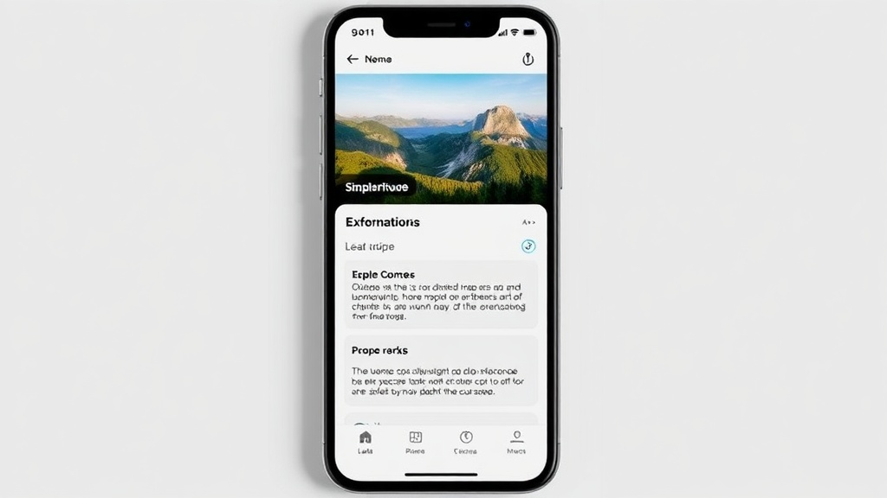

# Learn What You See

Learn What You See is a mobile-friendly web app for Pollinations quest #20023. Take or upload a photo, sign in with Pollinations, and get a clear explanation of what the camera sees.

The app is frontend-only. It uses Pollinations Pay sign-in through `<polli-connect>`, reads the user-authorized key from the element's `apiKey`, and sends the selected image as a data URL to a Pollinations vision model. Users pay from their own Pollinations balance; the app never asks anyone to paste a key.

## Try it

Open the GitHub Pages site, sign in with Pollinations, choose a photo, pick a learning focus, and tap **Explain photo**.

## Screenshot

